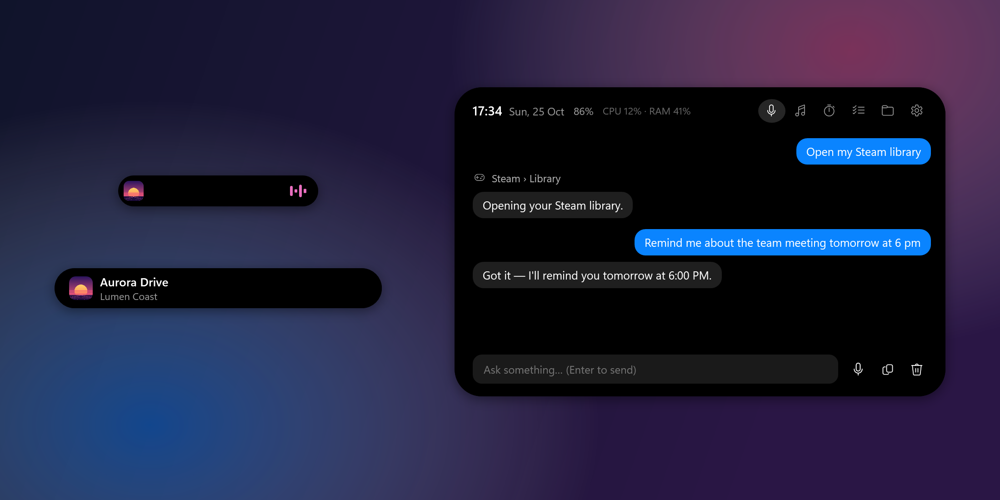
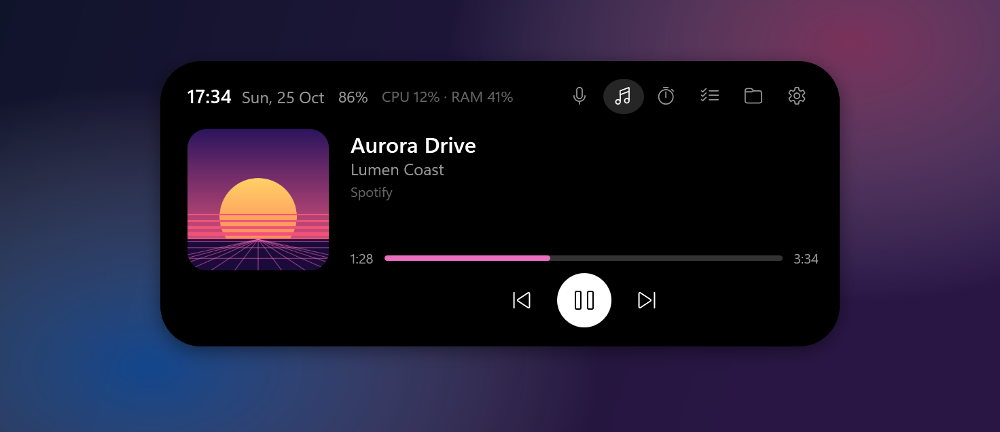
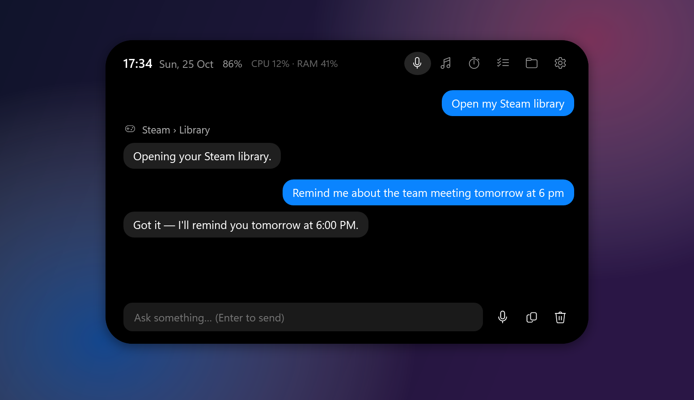
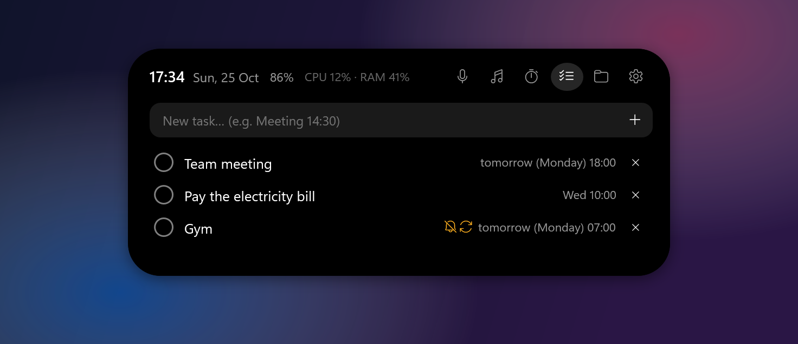
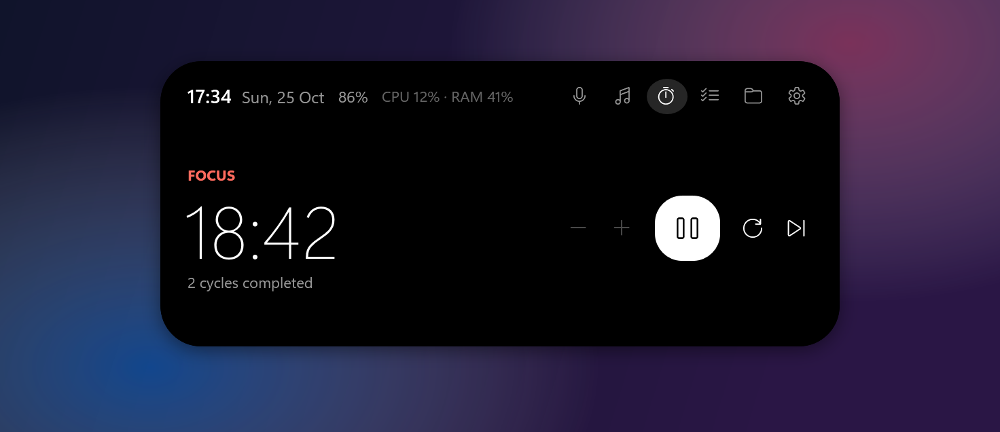
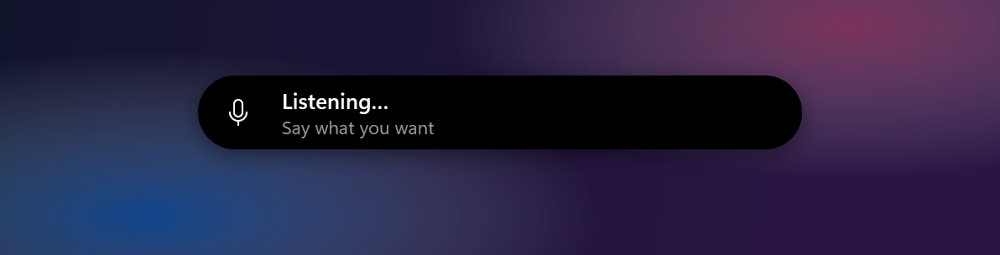
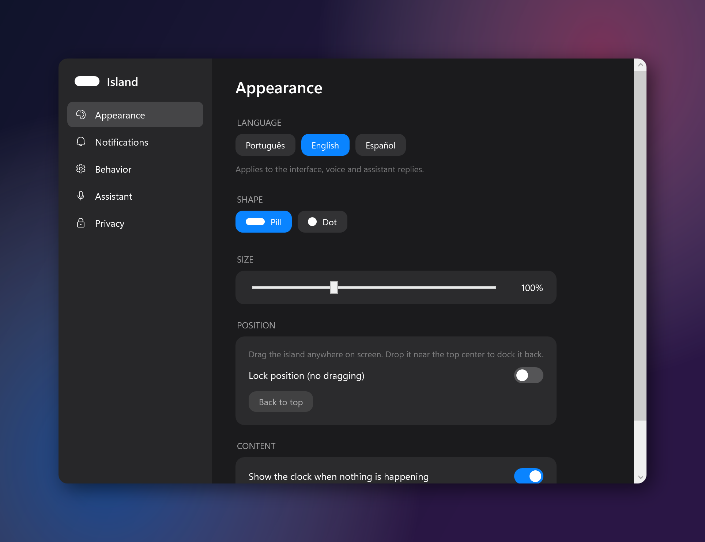
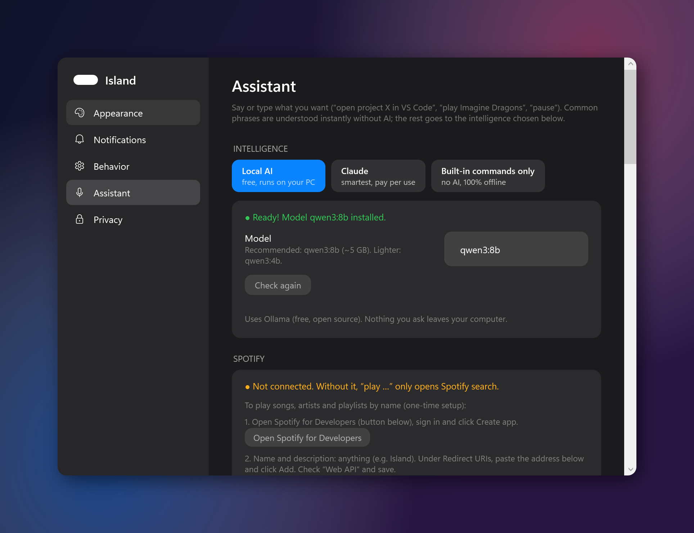

<p align="center"></p>

<h1 align="center">Island</h1>

<p align="center"><b>A Dynamic Island for Windows 10/11 — with a voice assistant that runs on your own PC.</b></p>

<p align="center"><a href="README.pt-BR.md">Português</a> · English</p>

<p align="center"></p>

Island sits at the top of your screen (or anywhere you drag it), expands when you hover over it and shows quick notices. Talk to it — “Hey Island, play Bohemian Rhapsody”, “open the project shop in VS Code”, “build it and tell me if it failed” — and it does it.

Native C# / WPF (.NET 8). Voice recognition and the default AI run **locally**: nothing you say leaves your computer unless you choose a cloud AI.

## Features

| | |
|---|---|
| **Voice assistant** | Wake word (“Hey Island” or “Jarvis”), a global shortcut (`Ctrl+Alt+Space`) or typing. Opens and builds projects, runs commands (with your approval), opens apps and sites, controls windows, music and volume, adds tasks and timers, tells you what's open on your PC. |
| **Spotify** | “Play …” any song, artist, album or playlist on your account (official Spotify API). |
| **Inside apps** | “Open the server X on Discord”, “open file Y in VS Code” (each app's quick switcher), plus reading/clicking/typing in native apps. Per-app volume: “set Spotify to 20%”. |
| **Media** | Cover, title and progress of whatever is playing (Spotify, YouTube in the browser…). Play/pause, previous/next, seek. Accent color from the cover. |
| **Focus timer** | Pomodoro, visible on the island while it runs. |
| **Tasks & alarms** | “Remind me on Monday at 6pm about the meeting”, “wake me up tomorrow at 7”, “alarm every day at 6:30”. Dates anywhere in the sentence; alarms ring until you say “stop” (or snooze). Ask “what are my reminders?”. |
| **Shelf** | Drop files on the island to keep them handy; drag them out later. |
| **Notices** | Volume, audio output, brightness, Caps Lock, keyboard language, charger, battery, network — each one can be turned off. |
| **Look** | Pill or dot shape, adjustable size, drag it anywhere (it grows toward the inside of the screen), hides in fullscreen. |
| **Languages** | Português, English, Español — interface, voice and replies. |
| **App shortcuts** | “Open my Steam library”, “Steam store”, “Bluetooth settings”, “task manager”, “dark mode”, “lock the PC” — 180+ parts of Steam, Epic, Discord, Spotify, browsers, VS Code and Windows. |
| **Browser tabs** | “Close the YouTube tab”, “go to tab 3”, “reopen the tab” — Chrome, Edge, Firefox, Opera, Brave. |
| **Internet** | Questions about news, scores, prices or weather are searched on the web (DuckDuckGo + Google News, no API key). |

## Screenshots

| | |
|---|---|
|  |  |
|  |  |
|  |  |
|  |  |

<sub>All screenshots use made-up data. Regenerate them with `Island.exe --screenshots <folder>` — the app draws itself with demo content and never reads or writes your own data.</sub>

## Install

1. Download `Island-win-x64.zip` from [Releases](../../releases), extract it anywhere and run `Island.exe`.
2. The **setup wizard** opens on first run. It detects your graphics card and memory and gets everything ready:
   - downloads the right **voice model** (Whisper) for your PC;
   - optionally installs **[Ollama](https://ollama.com)** (free, open-source local AI) and the right model size for your graphics card;
   - lets you pick the microphone and wake word.

You can reopen the wizard any time from the tray icon (near the clock) › *Setup wizard*.

### Requirements

- Windows 10 (1809+) or 11, x64.
- For the best voice model and the local AI: a graphics card with **4 GB+** of memory (8 GB+ recommended for local AI). Without one, Island picks lighter models, or you can use built-in commands only / Claude.

## How the assistant works

1. **Built-in commands** (always on, instant, offline) — “play …”, “pause”, “next”, “volume 30”, “open project X”, “build X”, “run project X”, “open Spotify”, “close Discord”, “timer for 25 minutes”, “remind me to X at 3pm”, “search X”, “what time is it”.
2. Anything else goes to the **intelligence** chosen in Settings › Assistant:
   - **Local AI** (default, free) — Ollama on your PC. Nothing leaves your computer.
   - **Claude** — smartest, pay per use (API key from [console.anthropic.com](https://console.anthropic.com/settings/keys)).
   - **Built-in commands only** — no AI.

Commands and closing windows always ask for your approval first (can be turned off).

### Connecting Spotify (optional)

Settings › Assistant › Spotify: create a free app at [developer.spotify.com/dashboard](https://developer.spotify.com/dashboard), add the redirect URI `http://127.0.0.1:8977/callback`, paste the Client ID and click *Connect*. Playing on demand needs Spotify Premium.

## Privacy

- **No keyboard hook.** Caps Lock is read from the key state; the shortcut uses `RegisterHotKey`, which only reports that one combination.
- **No administrator rights.**
- **Local data** in `%AppData%\Island` (settings, tasks, voice models, error log, optional diagnostic recordings).
- **Voice** is transcribed locally with Whisper. With the wake word on, the microphone stays open and each phrase is transcribed on your PC to look for it.
- **Network:** only if you use it — Claude (your request and tool results go to Anthropic), Spotify (searches), and downloading models during setup. API keys and tokens are encrypted with Windows DPAPI.

## Build from source

Requires the [.NET 8 SDK](https://dotnet.microsoft.com/download/dotnet/8.0).

```powershell
dotnet run                 # run
.\publish.ps1              # build the dist\ folder (needs the .NET 8 Desktop Runtime)
.\publish.ps1 -Portable    # same, with .NET included (what Releases ship)
```

GitHub Actions builds every pull request. To publish a release, open **Actions › Build › Run workflow** and type a version such as `v1.2.0` — it builds and attaches `Island-win-x64.zip` to that release.

### Adding a language

All texts are in [`Services/Strings.cs`](Services/Strings.cs) (one column per language) and registered in [`Services/Loc.cs`](Services/Loc.cs). Built-in voice commands per language are in [`Assistant/CommandRouter.cs`](Assistant/CommandRouter.cs) (`Grammar`).

## Project layout

```
App.xaml(.cs)                 styles, tray icon, single instance
MainWindow.xaml(.cs)          the island: states, animations, tabs, position, assistant chat
SettingsWindow.xaml(.cs)      settings
SetupWindow.xaml(.cs)         first-run wizard
Assistant/                    AssistantRouter → CommandRouter (built-in) → OllamaAssistant / ClaudeAssistant; AgentTools
Services/VoiceService.cs      microphone (NAudio) + speech detector + local Whisper + wake word
Services/SpotifyService.cs    Spotify Web API (PKCE)
Services/OllamaSetup.cs       installs and starts Ollama
Services/Hardware.cs          graphics card / memory detection and model recommendations
Services/Loc.cs, Strings.cs   languages
Services/…                    media, audio, system events, windows, storage, log
```

## License

[MIT](LICENSE)
