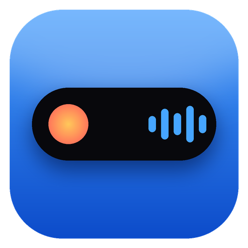
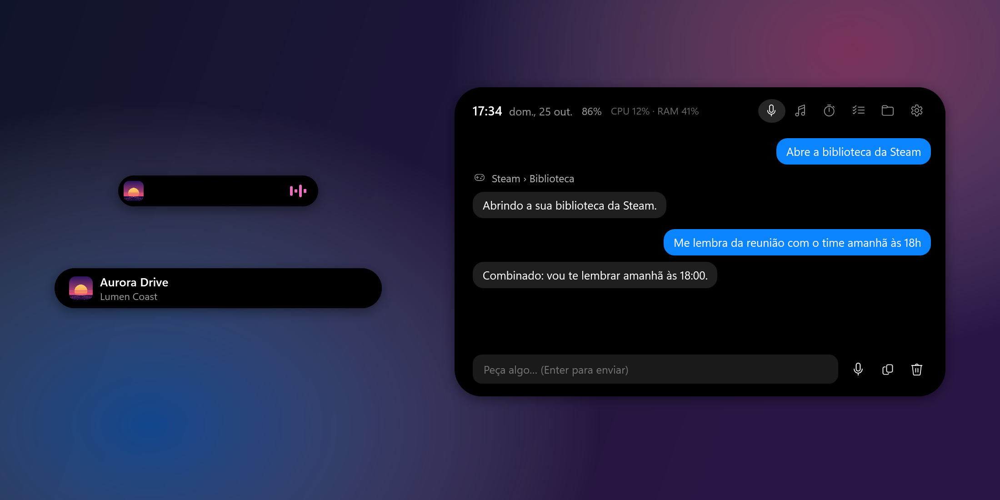
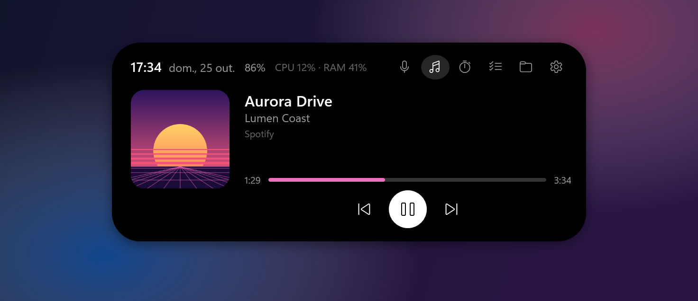
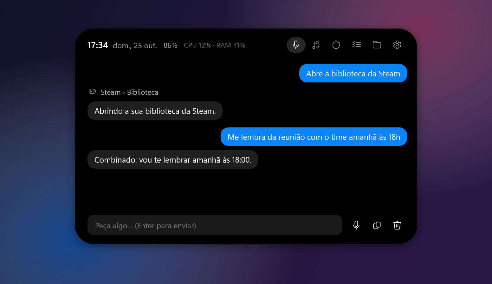
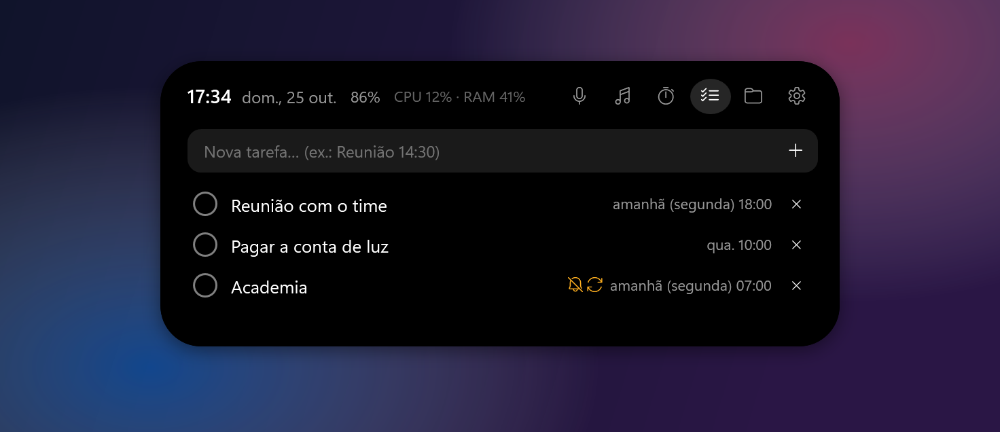
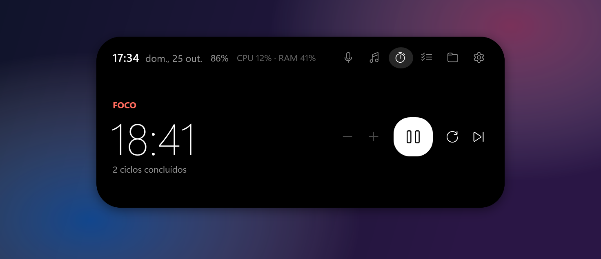
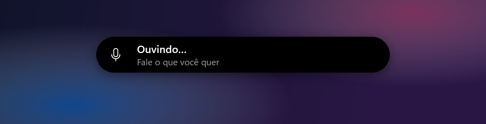
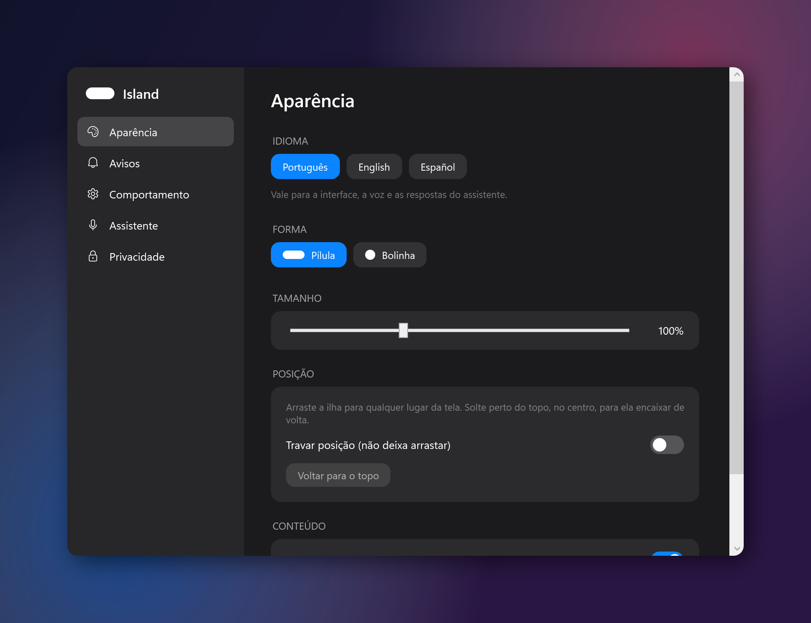
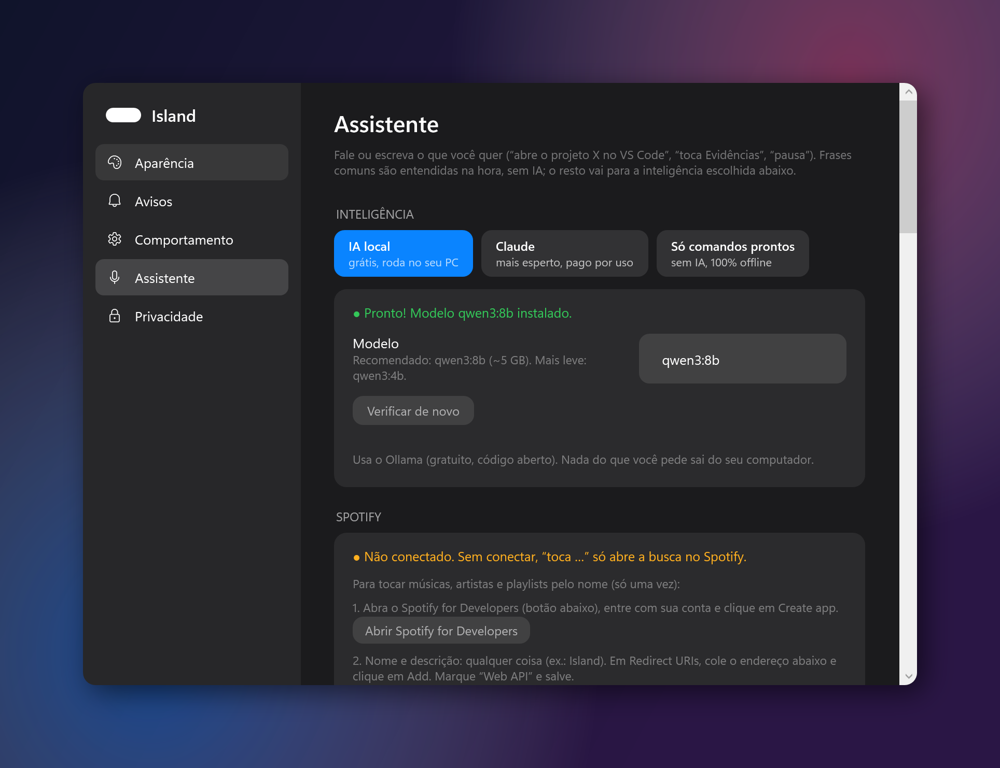

<p align="center"></p>

<h1 align="center">Island</h1>

<p align="center"><b>Uma "Dynamic Island" para Windows 10/11 — com um assistente de voz que roda no seu próprio PC.</b></p>

<p align="center">Português · <a href="README.md">English</a></p>

<p align="center"></p>

A Island fica no topo da tela (ou onde você arrastar), cresce quando você passa o mouse e mostra avisos rápidos. Fale com ela — “Ei Island, toca Evidências”, “abre o projeto loja no VS Code”, “compila e me diz se deu erro” — e ela faz.

C# / WPF nativo (.NET 8). O reconhecimento de voz e a IA padrão rodam **localmente**: nada do que você fala sai do computador, a não ser que você escolha uma IA na nuvem.

## Funções

| | |
|---|---|
| **Assistente de voz** | Palavra de ativação (“Ei, Island”, “Ei, Ilha” ou “Jarvis”), atalho global (`Ctrl+Alt+Space`) ou texto. Abre e compila projetos, roda comandos (com sua aprovação), abre apps e sites, controla janelas, música e volume, cria tarefas e timers, diz o que está aberto no PC. |
| **Spotify** | “Toca …” qualquer música, artista, álbum ou playlist da sua conta (API oficial do Spotify). |
| **Dentro dos apps** | “Abre o servidor X no Discord”, “abre o arquivo Y no VS Code” (busca rápida de cada app), e leitura/clique/digitação em apps nativos. Volume por app: “coloca o Spotify em 20%”. |
| **Mídia** | Capa, título e progresso do que estiver tocando. Tocar/pausar, anterior/próxima, pular para um ponto. Cor de destaque vinda da capa. |
| **Timer de foco** | Pomodoro, visível na ilha enquanto roda. |
| **Tarefas e alarmes** | “Me lembra segunda às 18h da reunião”, “me acorda amanhã às 7”, “alarme todo dia às 6 e meia”. Data em qualquer parte da frase; o alarme toca até você dizer “para” (ou soneca). Pergunte “quais os meus lembretes?”. |
| **Prateleira** | Solte arquivos na ilha para tê-los à mão; arraste para fora depois. |
| **Avisos** | Volume, saída de áudio, brilho, Caps Lock, idioma do teclado, carregador, bateria, rede — cada um pode ser desligado. |
| **Visual** | Pílula ou bolinha, tamanho ajustável, arraste para qualquer lugar (cresce para dentro da tela), some em tela cheia. |
| **Idiomas** | Português, English, Español — interface, voz e respostas. |
| **Atalhos dos apps** | “Abre a biblioteca da Steam”, “loja da Steam”, “configurações do Bluetooth”, “gerenciador de tarefas”, “modo escuro”, “bloqueia o PC” — mais de 180 partes da Steam, Epic, Discord, Spotify, navegadores, VS Code e Windows. |
| **Abas do navegador** | “Fecha a aba do YouTube”, “vai para a aba 3”, “reabre a aba” — Chrome, Edge, Firefox, Opera, Brave. |
| **Internet** | Perguntas sobre notícias, placares, preços ou clima são pesquisadas na web (DuckDuckGo + Google Notícias, sem chave de API). |

## Imagens

| | |
|---|---|
|  |  |
|  |  |
|  |  |
|  |  |

<sub>Todas as imagens usam dados inventados. Para gerar de novo: `Island.exe --screenshots <pasta>` — o app se desenha com conteúdo de demonstração e nunca lê nem grava os seus dados.</sub>

## Instalar

1. Baixe `Island-win-x64.zip` em [Releases](../../releases), extraia em qualquer pasta e abra `Island.exe`.
2. Na primeira vez abre o **assistente de configuração**, que detecta a placa de vídeo e a memória e deixa tudo pronto:
   - baixa o **modelo de voz** (Whisper) certo para o PC;
   - se quiser, instala o **[Ollama](https://ollama.com)** (IA local gratuita e de código aberto) e o modelo do tamanho certo para a sua placa;
   - escolhe microfone e palavra de ativação.

Dá para reabrir o assistente pelo ícone perto do relógio › *Assistente de configuração*.

### Requisitos

- Windows 10 (1809+) ou 11, 64 bits.
- Para o melhor modelo de voz e a IA local: placa de vídeo com **4 GB+** (8 GB+ recomendado para IA local). Sem ela, a Island escolhe modelos mais leves, ou você usa só os comandos prontos / o Claude.

## Como o assistente funciona

1. **Comandos prontos** (sempre ativos, instantâneos, offline) — “toca …”, “pausa”, “próxima”, “volume 30”, “abre o projeto X”, “compila o X”, “roda o projeto X”, “abre o Spotify”, “fecha o Discord”, “timer de 25 minutos”, “me lembra de X às 15h”, “pesquisa X”, “que horas são”.
2. O resto vai para a **inteligência** escolhida em Configurações › Assistente:
   - **IA local** (padrão, grátis) — Ollama no seu PC. Nada sai do computador.
   - **Claude** — mais esperto, pago por uso (chave em [console.anthropic.com](https://console.anthropic.com/settings/keys)).
   - **Só comandos prontos** — sem IA.

Comandos e fechar janelas sempre pedem sua aprovação antes (dá para desligar).

### Conectar o Spotify (opcional)

Configurações › Assistente › Spotify: crie um app grátis em [developer.spotify.com/dashboard](https://developer.spotify.com/dashboard), adicione o redirect URI `http://127.0.0.1:8977/callback`, cole o Client ID e clique em *Conectar*. Tocar sob demanda exige Spotify Premium.

## Privacidade

- **Sem hook de teclado.** Caps Lock é lido pelo estado da tecla; o atalho usa `RegisterHotKey`, que só avisa aquela combinação.
- **Sem administrador.**
- **Dados locais** em `%AppData%\Island` (configurações, tarefas, modelos de voz, registro de erros, gravações de diagnóstico opcionais).
- **Voz** transcrita localmente com o Whisper. Com a ativação por voz ligada, o microfone fica aberto e cada frase é transcrita no PC para procurar a palavra de ativação.
- **Internet:** só se você usar — Claude (o pedido e o resultado das ferramentas vão para a Anthropic), Spotify (buscas) e o download dos modelos na configuração. Chaves e tokens ficam criptografados com o DPAPI do Windows.

## Compilar

Precisa do [.NET 8 SDK](https://dotnet.microsoft.com/download/dotnet/8.0).

```powershell
dotnet run                 # roda
.\publish.ps1              # gera a pasta dist\ (precisa do .NET 8 Desktop Runtime)
.\publish.ps1 -Portable    # igual, já com o .NET incluso (é o que vai nos Releases)
```

O GitHub Actions compila cada pull request. Para publicar uma versão, abra **Actions › Build › Run workflow** e digite uma versão como `v1.2.0` — ele compila e anexa `Island-win-x64.zip` ao release.

## Licença

[MIT](LICENSE)
